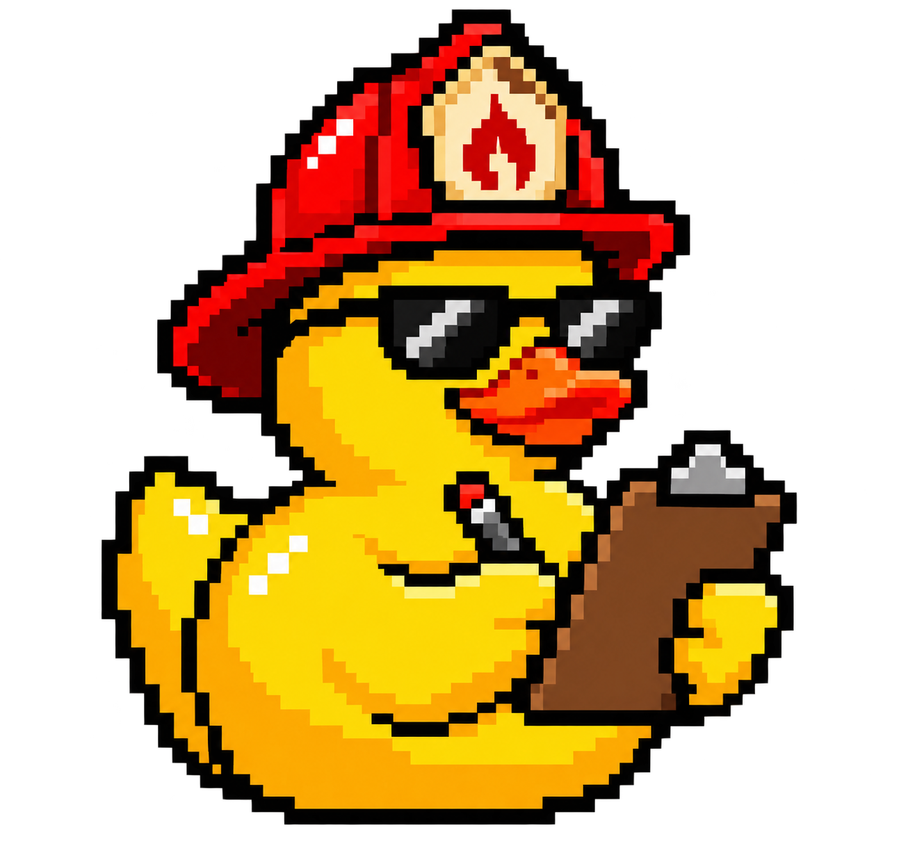
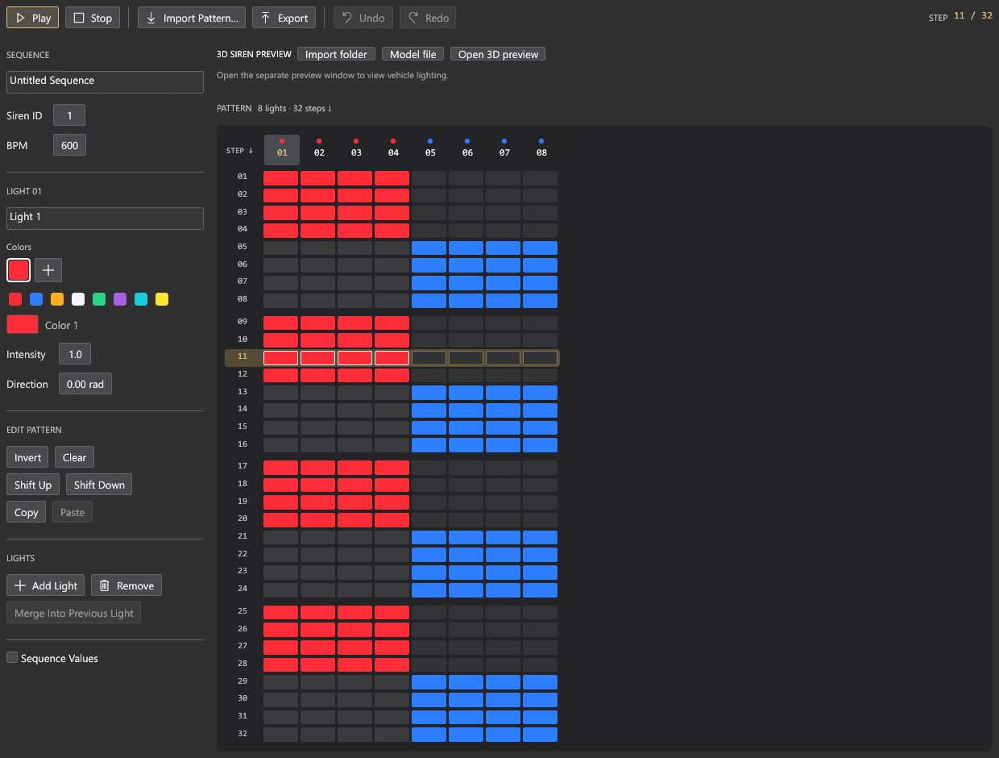
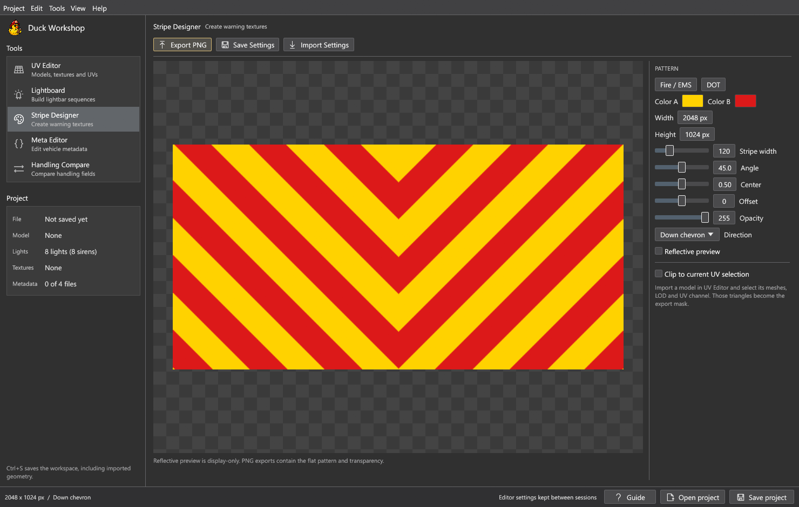

<p align="center">
  
</p>

<h1 align="center">Duck Workshop</h1>

<p align="center">
  <b>Build the details that make a FiveM vehicle your own.</b><br>
  A native Windows workbench for UVs, light sequences, warning textures, metadata and handling comparisons.<br>
  Free, open source, and maintained by Rubber Ducks Development.
</p>

<p align="center">
  
  
  
  
  
</p>

<p align="center">
  <a href="#get-started"><b>Get started</b></a> ·
  <a href="#screenshots">Screenshots</a> ·
  <a href="#features">Features</a> ·
  <a href="#file-support">File support</a> ·
  <a href="#build-from-source">Build from source</a> ·
  <a href="#documentation">Documentation</a>
</p>

> [!NOTE]
> **Early access.** Duck Workshop is actively being developed. Features and vehicle compatibility may change, and the 3D preview should be checked against the target vehicle in FiveM.
>
> **Windows release.** [Download Duck Workshop 0.3.4 Early Access](https://github.com/Rubber-Ducks-Development/duckworkshop/releases/tag/v0.3.4). Use DuckWorkshopSetup.exe to install it, or choose the Windows x64 ZIP for a portable copy. The tools process files locally; only optional update checks use the internet.

<p align="center">
  
  <br>
  <sub>The Lightboard editor with an eight-light demonstration pattern. Steps run from top to bottom.</sub>
</p>

<table>
  <tr>
    <td width="25%" valign="top"><h3>Models and UVs</h3>Recover existing UVs, inspect textures in 3D and export templates for your artwork.</td>
    <td width="25%" valign="top"><h3>Light sequences</h3>Paint 32-step patterns, preview timing and export carcols siren settings.</td>
    <td width="25%" valign="top"><h3>Warning textures</h3>Build transparent chevrons or stripes with precise dimensions, colors and UV masks.</td>
    <td width="25%" valign="top"><h3>Vehicle metadata</h3>Edit vehicle XML and compare handling values while preserving unrelated fields.</td>
  </tr>
</table>

## Screenshots

<p align="center">
  
  <br>
  <sub>Stripe Designer with a demonstration chevron. The checkerboard shows the canvas; exported PNGs preserve the selected pattern and transparency.</sub>
</p>

These are captures of the actual egui interface with original demonstration values.
No vehicle models or private workspaces are shown. See [image sources](docs/images/SOURCES.md).

## Features

| Tool | What you can do |
| --- | --- |
| UV Editor | Automatically isolate the livery material and UV channel, then export a 4096px colored surface guide with fine wireframe lines, or choose transparent outlines and wireframes. |
| Live textures | Load PNG, JPG, PSD, DDS and other supported images. Linked textures reload after a stable save, so artwork changes appear while you keep painting in another editor. |
| Lightboard | Paint a vertical 32-step sequencer, with lights across the top and time running downward, and preview flashing lightbar lens surfaces with their vehicle textures, glow and numbered labels. Use Night or Lightbar view, resize and pin the separate preview window. Import/export carcols and retain unrelated XML. |
| Stripe Designer | Choose six warning-stripe presets, mirror across an adjustable seam and add honeycomb or 3M 983-style reflective texture. Export transparent PNGs up to 8192 pixels per dimension, optionally clipped to the current UV selection. |
| Meta Editor | Edit handling, vehicles, carvariations and carcols files. Choose entries, use guided fields or raw XML, validate changes and export individual files or a resource ZIP. |
| Handling Compare | Match handling entries by name, filter changes and export CSV/JSON. Exact decimal-string comparison catches differences below floating-point precision. |
| Complete workspaces | Save geometry, patterns, metadata, comparison inputs and texture links in a `.duckworkshop` file. Source texture images remain in their existing locations. |
| Signed updates | Check on startup/every six hours or on demand; verify the release and download, save before restarting, and retain the old executable for recovery. |

Read the [user guide](docs/USER-GUIDE.md) for tool controls and detailed format limits.

## Get started

**Requirements:** Windows x64. The portable native application does not require a
browser runtime, account, subscription or API key. Editing and export work offline.

1. Download `DuckWorkshopSetup.exe` or the Windows x64 ZIP from
   [GitHub Releases](https://github.com/Rubber-Ducks-Development/duckworkshop/releases).
2. Run setup to install for your Windows account, or extract the ZIP to a writable
   folder and run `Duck-Workshop.exe`.
3. Choose one of the five tools. Import your own supported files, or create a light
   pattern, warning texture or metadata template.
4. Use **Project > Save** to keep a complete workspace before closing or updating.

| Download | Use it when |
| --- | --- |
| `DuckWorkshopSetup.exe` | You want guided installation, a Start menu shortcut and an uninstall entry. |
| `Duck-Workshop-<version>-Windows-x64.zip` | You want the portable app with documentation and license notices. |
| `Duck-Workshop.exe` | You want the standalone portable executable. |
| `SHA256SUMS.txt` | You want to compare the download's SHA256 with the published checksums. |
| `latest.json` | You maintain the update feed; the app reads this signed manifest automatically. |

Setup installs into `%LOCALAPPDATA%/Programs/Duck Workshop` by default. It includes
its own runtime, verifies the packaged files and keeps projects during repair and
uninstall. Administrator rights are not required. The portable ZIP remains available.
Private release assets require repository access.

## File support

| Type | Support and limits |
| --- | --- |
| `.duckworkshop` | Native workspace with editor data, imported geometry and links to external textures. Not interchangeable with Studio's `.duckproj`. |
| Legacy PC `.yft` / `.ydr` | RSC7 YFT version 162 and YDR version 165, including supported fragment drawables and empty geometry slots. Enhanced/Gen9, encrypted resources and unsupported vertex layouts need another supported conversion path. |
| CodeWalker XML / mapped OBJ / self-contained GLB | Recover existing UVs and mesh data. Complete finite UVs are required; no FBX, external GLB buffers, OBJ MTL loading or unwrapping. |
| PNG, JPG, PSD, DDS, TGA, BMP, TIFF, WebP, GIF | Texture preview. PSD favors the saved merged image; PSB/CMYK/32-bit PSD are unsupported. DDS support covers DXT1/3/5. Images are limited to 1 GB and 16384 pixels per side. |
| Vehicle `.meta` XML | Handling, vehicles, carvariations and carcols; nested and unknown elements are retained by the preserving XML workflow. |
| PNG / SVG / ZIP / CSV / JSON | Tool-specific exports for UV templates, patterns, resource bundles and handling comparisons. |

The 3D viewer is a texture check, rather than an in-game render. UV recovery does
not unwrap or modify the source model. Native previews apply rest-pose skinning, bone placement and intact fragment transforms.
CodeWalker XML geometry still uses raw positions; runtime articulation and full game lighting are not simulated. Siren lenses
use their bone bindings, imported scale factors and carcols facing angles. The lighting preview can read
nearby legacy PC YTD textures; no standalone YTD editor or YDD clothing import is
provided. UV exports cover the 0-1 tile.

Use **Import folder** in UV Editor or Lightboard to choose a FiveM vehicle resource,
then its vehicle and optional `_hi.yft`. The importer resolves texture dictionaries
and links carvariations sirenSettings to carcols IDs. Invalid, missing or conflicting
metadata is reported in **Import notes**; it never silently selects another pattern.
Imported vehicles only show sirens with actual bones or explicit manual positions.
Opening or dropping a YFT also loads its nearby matching settings and replaces the
current sequence. Numbered metadata downloads such as `carcols (1).meta` work without
renaming. The preview shows the active sequence and settings ID. Lenses without valid
scale metadata stay at their authored size with a visible warning; load the matching
settings for a correctly sized, facing and timed preview.
If an import fails, use **Copy import report** above the preview. Invalid color
reports include the value, siren number and XML location, with the Workshop version
and imported file fingerprint. These identify exactly what the importer read.

Each color of a Lightboard light exports as its own siren because carcols permits
one color per siren. The total exported setting supports up to 32 sirens. Check bone
placement, timing and behavior on your actual target vehicle.

## Workflow

1. **Inspect the model.** Import a mapped model, choose meshes/LOD/channel and load its textures.
2. **Prepare the artwork.** Export a UV template or warning texture; linked images refresh after saves.
3. **Build the light pattern.** Paint the sequencer, inspect the preview and export or merge carcols.
4. **Review the metadata.** Edit the vehicle files, link model/handling/siren IDs, and compare handling changes.
5. **Save and test.** Keep the `.duckworkshop` file, add your actual YFT/YTD assets to the exported resource, and test in FiveM.

New workspaces start without demonstration models or sample metadata. The patterns
shown in the screenshots were supplied only for documentation captures.

## Build from source

Use stable Rust **1.88 or newer** and the Visual Studio C++ build tools/Windows SDK
on Windows. Cargo downloads the open-source dependencies for the first build.

```powershell
git clone https://github.com/Rubber-Ducks-Development/duckworkshop.git
cd duckworkshop
cargo run --locked
```

Checks and an optimized build:

```powershell
cargo fmt --all -- --check
cargo test --all-targets --locked
cargo clippy --all-targets --locked -- -D warnings
cargo build --release --locked
```

The executable is `target/release/duck-workshop.exe`.

| Folder or module | Purpose |
| --- | --- |
| `src/ui.rs` and `src/ui/` | Native workbench, theme, sequencer and OpenGL preview |
| `src/models.rs`, `src/textures.rs`, `src/render.rs` | Model import, texture decoding, UV and stripe output |
| `src/patterns.rs`, `src/meta.rs`, `src/diff.rs` | Light patterns, preserving XML edits and handling comparison |
| `src/updates.rs` and `scripts/` | Verified portable updates and release signing |
| `tests/` | Original synthetic format, texture, project and update fixtures |
| `docs/` | User guide, compatibility, validation and dependency notices |

Maintainers: [RELEASING.md](RELEASING.md) covers PowerShell 7 packaging and the
external private key required to sign releases. Private signing keys stay outside Git.

## Updates and security

**Help > Check for updates** checks the stable signed feed. Automatic checks are on
by default at startup and every six hours; change them in **Help > Update settings**.
A newer verified release offers **Download update**, followed by **Save project and
restart**. Cancelling the save keeps the app open; discarding work requires confirmation.

The app verifies the pinned RSA-PSS-SHA256 manifest signature, product, stable version,
signed file size and SHA256. Redirects must stay on HTTPS. A helper waits for the
old process to exit, replaces only the application executable, and restores the old
file if installation or launch fails. Projects and source textures are retained.

The default feed needs public, published GitHub Releases. No GitHub token is embedded.
A different public HTTPS feed may be selected, but its manifests must match the
pinned key. Feed signatures are separate from Windows publisher signing; no
Authenticode publisher certificate is currently included.

Read [SECURITY.md](SECURITY.md) for reporting and current review limits, and
[RELEASING.md](RELEASING.md) for key handling and release recovery.

## Documentation

| Guide | Contents |
| --- | --- |
| [User guide](docs/USER-GUIDE.md) | Complete tool descriptions, shortcuts, previews and limits |
| [Compatibility](docs/COMPATIBILITY.md) | How Studio and Workshop share image workflows and differ in formats |
| [UI review](docs/UI-REVIEW.md) | Studio alignment and design decisions |
| [Validation](docs/VALIDATION.md) | Tested behavior and game/runtime verification limits |
| [Changelog](CHANGELOG.md) | Versioned changes |
| [Releasing](RELEASING.md) | Packaging, signing, publishing and recovery |
| [Security](SECURITY.md) | Private reporting and update trust |
| [Dependency notices](docs/DEPENDENCIES.md) | Locked dependency attribution and license texts |
| [README style](docs/README-STYLE.md) | Shared documentation format used across the app family |

## Rubber Ducks Development

Two companion workspaces with a shared visual language and different production jobs.

| App | What it is for | Workspace | Source and downloads |
| --- | --- | --- | --- |
| **Duck Studio** | Clothing collections, tattoos, outfits, texture workflows and pack builds | `.duckproj` | [Repository](https://github.com/Rubber-Ducks-Development/duck-studios) · [Releases](https://github.com/Rubber-Ducks-Development/duck-studios/releases) |
| **Duck Workshop** | Vehicle UVs, light patterns, warning textures, metadata and handling comparison | `.duckworkshop` | [Repository](https://github.com/Rubber-Ducks-Development/duckworkshop) · [Releases](https://github.com/Rubber-Ducks-Development/duckworkshop/releases) |

**Share images, keep projects separate.** Export a texture as PNG from Studio, inspect
or edit it in Workshop, then replace the image in Studio. Workshop's transparent
stripe PNGs can also be imported into Studio. The two workspace schemas are not
interchangeable; Workshop does not directly import clothing YDD/YTD packages.

## Contributing

Read [CONTRIBUTING.md](CONTRIBUTING.md) and run the focused format, project and update
checks before submitting changes. Use original synthetic fixtures instead of
redistributing game assets. Preserve source models and unrelated metadata.

Use [bug reports](https://github.com/Rubber-Ducks-Development/duckworkshop/issues/new?template=bug_report.yml)
for reproducible problems and [feature requests](https://github.com/Rubber-Ducks-Development/duckworkshop/issues/new?template=feature_request.yml)
for a concrete workflow improvement. Include the tool name, app version and a
minimal example you have permission to share. Report vulnerabilities privately through [SECURITY.md](SECURITY.md).

## License and credits

Duck Workshop uses the [MIT license](LICENSE). Dependencies keep their own licenses;
the inventory and copied notices are in [docs/DEPENDENCIES.md](docs/DEPENDENCIES.md).

The firefighter duck artwork was supplied by the project owner. Documentation images
show actual app controls with original demonstration patterns; see
[image sources](docs/images/SOURCES.md). No proprietary editor artwork or code is
included. Duck Workshop is independent of Rockstar Games and FiveM.

<p align="center"><sub>Made by Rubber Ducks Development.</sub></p>
